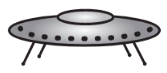

# Opgaven



```{tableofcontents}
```

De opstap is er om je te helpen als je moeite hebt.  
De basisopgave is een zelftest: je gaat na of je de stof van deze week hebt begrepen.  
De extra opgave is er om je uit te dagen.

De [basis](/problems/11_basis) heeft twee delen:

- {ref}`De nacht van het nijlpaard <problems-11-nijlpaard>`, stappen 1–3.
  Begin hieraan na het eerste college.
- {ref}`De uitslag van de schoolrun <problems-11-schoolrun>`, stappen 4–8 en
  opdracht 1. Begin hieraan na het tweede college.

De [extra](/problems/11_extra) heeft drie delen. Elk deel staat op zichzelf en heeft
een uitwerking:

- {ref}`Pijlenpad <problems-11-pijlenpad>`, stappen 1–5.
- {ref}`Periodiek T-shirt <problems-11-periodiek-t-shirt>`, stappen 6–8.
- {ref}`Caesar op orde <problems-11-caesar-op-orde>`, opdrachten 1–7. Je schrijft
  een reeks functies met recursie, *use it or lose it* en `key=`. Dit deel herhaalt
  de stof van beide colleges.
